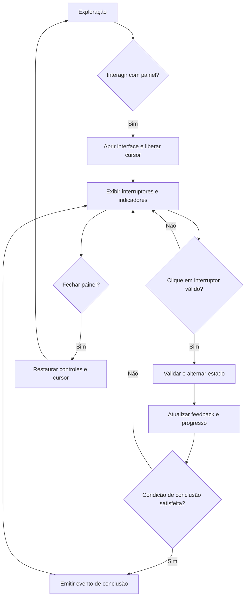

# Skill — Painel interativo de interruptores com mouse

## Papel da IA
Você é um desenvolvedor de gameplay e interfaces. Implemente uma mecânica de interação com painel de interruptores baseada no vídeo fornecido pelo usuário, adaptada para um jogo em que **o mouse serve exclusivamente para apontar e clicar enquanto o painel estiver aberto**, sem movimentar a câmera.

## Evidência observada e limites
No vídeo de aproximadamente 60 segundos, há um painel escuro com múltiplos interruptores retangulares iluminados em vermelho e verde, indicadores luminosos menores, alternância visual de estados e um objetivo relacionado a ativar geradores. A interface apresenta indicação de interação (por exemplo, flip e exit) e progresso. Há aproximações e afastamentos da visão do painel.

**Não inferir do vídeo como fatos:** sequência obrigatória, relação elétrica real entre interruptores, regra de vitória exata, número fixo de geradores, persistência de estados ou penalidades. Esses comportamentos são configuráveis e precisam de validação no projeto.

## Resultado desejado
Ao interagir com um objeto de painel no mundo, abrir uma interface de jogo em primeiro plano, como um modal, com o painel em destaque. O jogador usa o cursor para clicar nos interruptores. A câmera e a movimentação do personagem ficam desabilitadas enquanto a interface está aberta. A interface deve conservar a estética diegética/industrial do vídeo, sem parecer um formulário HTML genérico.

## Fluxo principal
1. Jogador se aproxima de um painel interativo.
2. O jogo apresenta um indicativo de interação, quando aplicável.
3. Jogador aciona a tecla/botão de interação.
4. O sistema entra no estado `PANEL_OPEN`, bloqueia controles de câmera e movimentação e libera/exibe o cursor.
5. A interface do painel aparece sobre a cena, com fundo escurecido ou cenário preservado ao fundo.
6. O jogador posiciona o cursor sobre um interruptor; o controle indica hover/foco.
7. Clique válido solicita a alternância do interruptor.
8. O sistema valida se o interruptor está habilitado, aplica a mudança, atualiza a representação visual, indicadores, sons e progresso.
9. Quando a condição configurada for satisfeita, emite um evento de puzzle concluído e apresenta feedback de sucesso.
10. Ao fechar por botão/tecla configurada, a interface some, o cursor volta à política anterior e os controles do jogo são restaurados.



## Requisitos funcionais
- RF01: Permitir abrir o painel a partir de uma interação explícita com objeto do mundo.
- RF02: Enquanto aberto, impedir que movimento do mouse altere a câmera.
- RF03: Enquanto aberto, liberar e tornar visível o cursor para apontar e clicar.
- RF04: Impedir movimentação e outras ações conflitantes do personagem enquanto o painel estiver aberto.
- RF05: Renderizar controles clicáveis com regiões de clique alinhadas aos elementos visuais.
- RF06: Representar pelo menos os estados `ON`, `OFF` e `DISABLED`, com aparência distinguível.
- RF07: Alternar um controle apenas uma vez por clique válido, evitando múltiplos acionamentos por um único evento.
- RF08: Reproduzir feedback visual e, quando houver recursos disponíveis, sonoro para hover, clique, erro e conclusão.
- RF09: Exibir progresso e indicadores com base no estado do sistema, nunca apenas em efeitos cosméticos independentes.
- RF10: Permitir fechar o painel e restaurar exatamente a política de input anterior.
- RF11: Emitir eventos para sistemas externos (geradores, portas, missões, energia), sem acoplar diretamente os botões a esses sistemas.
- RF12: Definir comportamento de reabertura e persistência conforme configuração do projeto.

## Máquina de estados
**Interface:** `CLOSED -> OPENING -> OPEN -> CLOSING -> CLOSED`.

**Interruptor:** `OFF <-> ON`; `DISABLED` bloqueia alterações; `LOCKED` é estado opcional para regras de puzzle.

**Puzzle:** `NOT_STARTED -> IN_PROGRESS -> COMPLETED`, com `FAILED` opcional somente se houver regra de falha definida.

Separar estado do puzzle do estado visual. Animações de abertura/fechamento não podem provocar cliques fantasmas nem deixar o input travado.

## Modelo de dados sugerido
```text
PanelConfig
  id
  title
  switches: SwitchConfig[]
  completionRule
  closePolicy
  persistencePolicy

SwitchConfig
  id
  initialState: ON | OFF
  enabled: boolean
  position
  visualStyle
  optionalDependencies

PanelRuntimeState
  panelId
  isOpen
  switchStates: Map<switchId, ON | OFF>
  completed
  progress
```

O número e a disposição dos interruptores devem ser configuráveis. Como referência estética, usar duas fileiras assimétricas de interruptores verticais com indicadores pequenos próximos, sem fixar a quantidade com base em frames do vídeo.

## Regras de arquitetura
- Criar componentes separados para `PanelInteractionTrigger`, `PanelController`, `PanelView`, `SwitchView`, `PuzzleRules`, `InputModeManager` e `FeedbackController` (nomes adaptáveis à engine).
- `PanelView` recebe estado e emite intenção de clique; não calcula vitória.
- `PuzzleRules` determina transições válidas e condição de conclusão; não depende da renderização.
- `InputModeManager` deve capturar e restaurar o modo anterior de cursor, câmera, movimentação e foco.
- Usar eventos/sinais para informar outros sistemas sobre `SwitchToggled`, `PanelOpened`, `PanelClosed` e `PuzzleCompleted`.
- Evitar dependências de bibliotecas não presentes no projeto e respeitar a arquitetura, engine, linguagem e sistema de input existentes.
- Caso o projeto seja web (Canvas/WebGL), aplicar captura de eventos no overlay, liberar pointer lock ao abrir e restabelecê-lo conforme gesto/permissão do navegador ao fechar; não assumir que pointer lock pode ser recuperado automaticamente.

## Comportamento visual e UX
- Painel com fundo metálico escuro, interruptores verticais vermelhos (desligados) e verdes (ligados), iluminação sutil e pequenos LEDs indicadores.
- Hover: realce discreto; clique: movimento curto de alavanca/botão e troca de cor; disabled: visual atenuado e sem ação.
- Overlay central ou ocupando a maior parte da tela, adaptável à resolução e proporção; manter área clicável consistente em diferentes escalas.
- Fundo do jogo pode ser escurecido, mas o painel deve continuar legível.
- Botão/atalho de saída visível, com Escape como padrão configurável.
- Não permitir clique no cenário por trás da interface.
- Considerar contraste, indicação de estado além da cor e navegação por teclado quando compatível com o projeto.

## Condição de vitória — política configurável
**Não presumir que todos os interruptores verdes representam vitória.** A IA deve primeiro identificar a regra de negócio do jogo. Na ausência dela, implementar uma estratégia de condição de conclusão injetável, com um exemplo simples `allRequiredSwitchesOn`, claramente identificado como comportamento provisório.

O progresso deve representar a métrica real da missão (por exemplo, geradores ligados), e não necessariamente a quantidade de interruptores em `ON`.

## Critérios de aceitação
1. Com o painel fechado, câmera e movimentação operam normalmente.
2. Ao abrir o painel, mover o mouse altera somente o cursor, nunca a direção da câmera.
3. Clique em interruptor válido alterna exatamente um estado e atualiza seu feedback.
4. Clique fora do painel ou em controle desabilitado não modifica o puzzle.
5. Indicadores e progresso refletem os dados do controlador.
6. A conclusão ocorre somente quando a regra configurada é satisfeita, e o evento é emitido uma única vez por conclusão.
7. Fechar/reabrir respeita a política de persistência definida.
8. Após fechar, os controles do personagem não ficam bloqueados e o cursor segue a política original.
9. Repetidas aberturas/fechamentos não acumulam listeners, eventos ou overlays.
10. Em resoluções diferentes, controles visuais e hitboxes permanecem alinhados.

## Plano de implementação da IA
1. Inspecionar a estrutura atual do jogo e identificar engine/framework, sistema de input, renderização e convenções.
2. Localizar o controlador de câmera e a interação com objetos do mundo.
3. Propor arquivos e interfaces mínimos, justificando a separação de responsabilidades.
4. Implementar primeiro o modo de input modal, com abertura e fechamento confiáveis.
5. Implementar o painel visual e a detecção de clique.
6. Conectar o estado dos interruptores a regras de puzzle configuráveis.
7. Integrar indicadores, feedback, áudio e eventos de missão.
8. Testar critérios de aceitação e casos extremos.
9. Entregar resumo dos arquivos alterados, decisões tomadas, hipóteses pendentes e passos para teste manual.

## Restrições para a IA
- Não implementar rotação de câmera para selecionar interruptores.
- Não exigir mira central ou raycast de câmera durante a interação modal; usar hit-testing do cursor na UI. Raycast no mundo pode ser usado somente para abrir o painel.
- Não criar uma aplicação web externa ou navegar para outra página.
- Não inventar sequência de interruptores, temporizador, penalidade ou reset automático.
- Não substituir sistemas de input existentes sem investigar dependências.
- Não alterar outras mecânicas do jogo sem necessidade.
- Não fornecer código genérico como implementação final sem antes verificar a stack do repositório.

## Perguntas a resolver apenas quando não puderem ser inferidas do projeto
- Qual engine/framework e sistema de UI são usados?
- Qual é a regra exata de conclusão do puzzle?
- O painel deve guardar estados ao ser fechado ou reiniciar?
- A conclusão ativa qual elemento do mundo (gerador, porta, missão etc.)?

## Definição de pronto
A experiência deve se parecer com a interação do vídeo no ritmo e no feedback dos interruptores, mas operar como **um modal de jogo controlado por mouse**, sem rotação de câmera, com lógica de puzzle independente e integração segura ao restante do gameplay.
